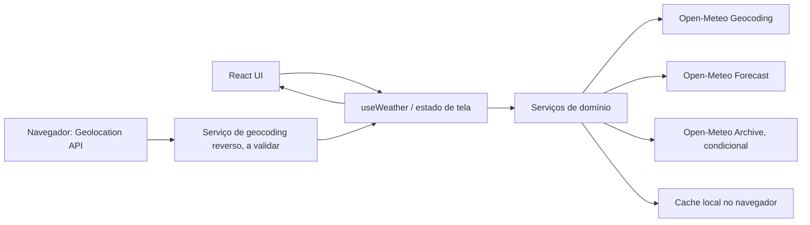

# Plano Técnico — Weather App

## Architecture

Aplicação cliente única em React + Vite, sem backend próprio, autenticação ou persistência de produto no servidor. A UI consome os serviços meteorológicos diretamente do navegador; estado de tela, preferências, favoritas, cidade lembrada e cache vivem no cliente.



**Gate anterior à implementação:** realizar a prova de conceito (PoC) do Open-Meteo para cobertura, campos, limites e termos de uso. Busca por código postal e histórico só permanecem no MVP se a PoC comprovar suporte suficiente. Se outra capacidade essencial falhar, suspender implementação e obter decisão de escopo. A PoC também deve validar como resolver coordenadas do dispositivo em uma cidade; não assumir que o serviço de geocoding escolhido oferece geocoding reverso.

Princípios arquiteturais:

- Separar UI, estado de interação e acesso a serviços externos.
- Normalizar respostas externas para modelos de domínio antes de chegar aos componentes.
- Manter estados e erros independentes por bloco meteorológico, mesmo quando clima atual e previsão vierem da mesma resposta HTTP.
- Não gravar coordenadas precisas do dispositivo, respostas de API ou dados do usuário no servidor.
- Não coletar analytics no MVP.

## Tech Stack

| Área | Decisão | Uso |
|---|---|---|
| Linguagem | TypeScript em modo strict | Contratos e modelos de domínio. |
| UI | React 19 + Vite | Site responsivo de página única. |
| Estilo | Tailwind CSS 3 | Seguir o tema e os padrões já definidos no repositório. |
| Dados meteorológicos | Open-Meteo, sem API key | Geocoding, previsão e, condicionalmente, arquivo histórico. |
| Estado | React `useReducer`/hooks locais | Sem biblioteca de estado adicional para este escopo. |
| Persistência cliente | `localStorage` com leitura/escrita defensiva | Preferência, favoritos, cidade lembrada e cache com TTL. |
| Testes unitários/componentes | Vitest + Testing Library | Funções, serviços e estados da UI. |
| Testes E2E | Playwright | Fluxos completos e viewports desktop/mobile. |
| Lint/format | Biome | Seguir configuração existente. |
| Gerenciador | pnpm | Comandos e dependências do workspace atual. |

Não adicionar biblioteca de query, estado global, backend ou camada de autenticação sem necessidade demonstrada. Os scripts e versões instaladas estão definidos em `package.json`.

## Project Structure

Manter a estrutura atual e adicionar módulos somente onde a separação de responsabilidades exigir:

```text
src/
  components/
    CurrentWeather.tsx
    ForecastCard.tsx
    ForecastList.tsx
    SearchBar.tsx
    UnitToggle.tsx
    states/
      EmptyState.tsx
      ErrorState.tsx
      LoadingState.tsx
  hooks/
    useWeather.ts
  lib/
    format.ts
    temperature.ts
    weatherCodes.ts
    weatherCache.ts          # cache local versionado e TTL
  services/
    weatherService.ts        # cliente e normalização Open-Meteo
    geocodingService.ts      # busca de cidades e, se necessário, geocoding reverso
    geolocationService.ts    # wrapper da Geolocation API do navegador
  types/
    weather.ts               # modelos de domínio e estados de serviço
  styles/
    index.css

tests/
  unit/
    weatherService.test.ts
    geocodingService.test.ts
    weatherCache.test.ts
    temperature.test.ts
    weatherCodes.test.ts
  e2e/
    weather.spec.ts
```

Os nomes acima são responsabilidades propostas, não arquivos de implementação a criar agora. Se a PoC retirar o histórico ou busca postal, remover seus contratos, critérios e cobertura de teste antes da fase Code.

## Data Model

Armazenar temperaturas normalizadas em Celsius e converter somente na apresentação. Datas/hora devem manter o offset ou fuso da cidade; não reinterpretar datas locais como UTC.

```ts
export type TemperatureUnit = "celsius" | "fahrenheit";

export interface City {
  id: string;
  name: string;
  region?: string;
  country: string;
  latitude: number;
  longitude: number;
  timezone: string;
}

export interface CurrentWeather {
  observedAt: string;
  conditionCode: number;
  temperatureC: number;
  feelsLikeC: number;
  todayMinC: number;
  todayMaxC: number;
  windSpeedKmh: number;
  relativeHumidityPercent: number;
  precipitationProbabilityRemainingDayPercent: number | null;
}

export interface DailyWeather {
  date: string;
  conditionCode: number;
  minC: number;
  maxC: number;
  precipitationProbabilityPercent: number | null;
}

export interface HistoricalDay extends DailyWeather {
  precipitationObservedMm: number | null;
}

export interface WeatherSnapshot {
  city: City;
  fetchedAt: string;
  current: CurrentWeather | null;
  forecast: DailyWeather[] | null;
}

export interface WeatherHistory {
  cityId: string;
  fetchedAt: string;
  days: HistoricalDay[];
}

export type WeatherBlock = "current" | "forecast" | "history";
export type DataFreshness = "fresh" | "stale";

export type AsyncBlock<T> =
  | { status: "idle" }
  | { status: "loading"; previous?: T }
  | { status: "success"; data: T; freshness: DataFreshness; fetchedAt: string }
  | { status: "error"; code: WeatherErrorCode; message: string; fallback?: T; fetchedAt?: string };

export type WeatherErrorCode =
  | "network"
  | "timeout"
  | "http"
  | "invalid_response"
  | "quota"
  | "not_found"
  | "unsupported";

export interface FavoriteCity {
  city: City;
  savedAt: string;
}

export interface StoredValue<T> {
  schemaVersion: 1;
  savedAt: string;
  value: T;
}
```

**Contratos e invariantes:**

- `City.latitude`/`longitude` são as coordenadas da cidade resolvida. Coordenadas brutas do dispositivo nunca fazem parte de `City`, `WeatherSnapshot`, armazenamento local ou requisição meteorológica.
- Campos que podem faltar por cobertura do provedor são `null` ou levam ao estado indisponível do bloco; nunca converter ausência em zero.
- `WeatherSnapshot.current` e `forecast` têm estados de UI separados. Um campo faltante não invalida outros campos recebidos; a regra de completude para a métrica de PoC/release considera o bloco uma falha se faltar campo requerido.
- `WeatherHistory` e suas operações só entram no contrato do MVP após a PoC.
- O método para calcular a probabilidade de chuva do restante do dia continua pendente de validação do provedor; o modelo usa `null` quando não houver valor calculável/aprovado.
- `StoredValue` inclui versão de schema e timestamp para possibilitar descartar entradas incompatíveis ou expiradas.

## Data Flow

1. O usuário digita uma busca. Normalizar espaços; para vazio ou menos de dois caracteres, não chamar geocoding. Acima do limite, consultar até cinco sugestões. O intervalo de debounce ainda depende de decisão registrada na spec.
2. `geocodingService` converte o resultado do Open-Meteo para `City`. Para nomes homônimos, a UI exige seleção explícita; nenhuma consulta meteorológica ocorre antes da seleção.
3. Ao selecionar a cidade, `weatherService` solicita clima atual e previsão usando latitude/longitude da cidade e `timezone=auto`. Normaliza os campos e os separa por bloco para a UI.
4. A UI atualiza os estados de clima e previsão independentemente. Valores ausentes ficam indisponíveis; resposta parcial não apaga os demais campos/blocos válidos.
5. A resposta é guardada no cache local por cidade e bloco, com timestamp. Cache expira após 24 horas. Preferência de unidade, até cinco favoritas e cidade resolvida (se houver consentimento, por 30 dias) também são locais.
6. A previsão usa hoje e os quatro dias seguintes no fuso local da cidade. O histórico condicional é solicitado somente quando a aba de histórico abre, para hoje-7 até ontem no calendário local da cidade.
7. A atualização automática ocorre a cada 30 minutos enquanto a página está visível. Pausar enquanto oculta; ao retornar, atualizar imediatamente se o último dado tiver 30 minutos ou mais. Atualização manual segue o mesmo fluxo.
8. Fluxo de localização: após ação explícita e permissão do navegador, `geolocationService` obtém coordenadas precisas em memória. Transmiti-las somente ao serviço escolhido para resolver a cidade. Descartá-las após a resolução; solicitar dados meteorológicos usando apenas as coordenadas de `City`. A PoC deve determinar o serviço/endereço de geocoding reverso, pois não está definido pela spec.
9. Em falha, procurar cache local válido para o mesmo bloco. Mostrar cache com marcador stale e `fetchedAt`; sem cache válido, mostrar erro e ação de retry. Não gravar respostas meteorológicas no servidor.
10. Analytics permanece desligado: nenhum evento, payload de usuário ou chamada de coleta é gerado.

## External APIs

### Open-Meteo Geocoding

- **Base:** `https://geocoding-api.open-meteo.com/v1/search`
- **Uso previsto:** busca direta por nome e desambiguação, com `count=5`, idioma pt e formato JSON.
- **Parâmetros de entrada:** texto normalizado; considerar `name`, `count`, `language` e `format` conforme documentação vigente.
- **Saída normalizada:** `City[]`, incluindo identificador, nome, região, país, latitude, longitude e timezone quando disponível.
- **PoC:** testar nomes internacionais, homônimos, alias/acentos e cobertura por região. Busca postal é condicional; não manter no MVP se falhar.
- **Debounce/limites:** debounce e volume de autocomplete ainda devem ser definidos; não presumir que o limite diário de consultas de clima inclui chamadas de geocoding.

### Open-Meteo Forecast

- **Base:** `https://api.open-meteo.com/v1/forecast`
- **Uso previsto:** um pedido por cidade selecionada para dados atuais e previsão diária de cinco dias; obter dados horários necessários à probabilidade de chuva somente se o provedor oferecer definição compatível.
- **Parâmetros conceituais:** `latitude`, `longitude` da cidade resolvida, `timezone=auto`, `forecast_days=5`, variáveis atuais para temperatura, sensação térmica, condição, vento e umidade, variáveis diárias para condição, máxima/mínima e probabilidade de chuva, e variáveis horárias de precipitação quando necessárias.
- **Mapeamento:** codificar as variáveis exatas após a PoC e conferir unidades, disponibilidade e semântica dos timestamps. Usar código WMO para mapear condições por `weatherCodes.ts`.
- **Não enviar:** coordenadas precisas obtidas diretamente do dispositivo; enviar somente latitude/longitude da cidade resolvida.

### Open-Meteo Archive (condicional)

- **Base:** `https://archive-api.open-meteo.com/v1/archive`
- **Uso previsto:** histórico diário de sete datas anteriores somente se a PoC confirmar os campos requeridos e cobertura suficiente.
- **Parâmetros conceituais:** latitude/longitude da cidade, `start_date`/`end_date` no fuso local, `daily` com código de condição, temperatura máxima/mínima e precipitação observada, além de `timezone=auto`.
- **Gate:** se suporte for insuficiente, excluir FR-04, US-03 relacionado ao histórico e AC-03.1 a AC-03.3 do escopo de implementação. Não substituir automaticamente por outro serviço.

### Geocoding reverso da localização

- **Entrada:** coordenadas temporárias obtidas pela Geolocation API do navegador após ação explícita do usuário.
- **Saída:** cidade resolvida e coordenadas representativas dessa cidade.
- **Provedor:** ainda não definido/validado na spec. A PoC deve identificar se Open-Meteo atende ao fluxo; caso contrário, obter decisão de serviço e termos antes de implementar localização.
- **Privacidade:** coordenadas brutas não são armazenadas nem enviadas ao endpoint meteorológico. O serviço de reverse geocoding recebe as coordenadas apenas para localizar a cidade.

## State Management

Usar `useReducer` encapsulado em `useWeather` para coordenar seleção de cidade, pesquisa, refresh e estados independentes dos blocos. Evitar biblioteca de estado global e efeitos de rede dentro de componentes de apresentação.

Estado mínimo proposto:

```ts
export interface WeatherPageState {
  query: string;
  suggestions: AsyncBlock<City[]>;
  selectedCity: City | null;
  current: AsyncBlock<CurrentWeather>;
  forecast: AsyncBlock<DailyWeather[]>;
  history: AsyncBlock<WeatherHistory>;
  activeView: "forecast" | "history";
  unit: TemperatureUnit;
  favorites: FavoriteCity[];
  rememberedCity: City | null;
}
```

- Ações do reducer devem representar eventos observáveis (`SEARCH_STARTED`, `CITY_SELECTED`, `BLOCK_SUCCEEDED`, `BLOCK_FAILED`, `REFRESH_REQUESTED`, `VISIBILITY_CHANGED`, `UNIT_CHANGED`, `FAVORITE_ADDED`, `FAVORITE_REMOVED`).
- Serviços recebem parâmetros explícitos e retornam dados normalizados ou erros tipados; o hook decide transições de estado.
- `localStorage` é acessado por adaptador simples que valida JSON e schema, trata `SecurityError`/quota e degrada para sessão em memória sem bloquear consultas.
- Não guardar coordenadas do dispositivo, eventos de analytics ou dados pessoais no estado persistido.
- Conversão de unidade e formatação são funções puras na camada `lib`; estado interno permanece em Celsius.

## Error Handling

| Condição | Estado/ação | Resultado visível e persistência |
|---|---|---|
| Busca vazia ou menor que dois caracteres | Não iniciar geocoding | Campo permanece editável; sem erro de API. |
| Sem resultados de geocoding | Estado vazio | Informar cidade não encontrada e sugerir correção; não solicitar weather. |
| Cidades homônimas | Estado de seleção | Listar cidade/região/país; só buscar após escolha. |
| Permissão negada ou geolocalização falha | Erro do fluxo de localização | Preservar busca manual; descartar coordenadas temporárias. |
| Serviço de geocoding reverso não disponível | Erro de localização | Mensagem e busca manual; não consultar clima por coordenada bruta. |
| Timeout | Erro tipado `timeout` | O timeout efetivo é configuração pendente; ao expirar, usar cache válido ou retry. |
| Falha de rede, HTTP, schema inesperado ou cota | Erro por bloco | Manter blocos válidos; usar cache local de até 24h com rótulo stale, senão mensagem e retry. |
| Campo opcional ausente | Valor indisponível | Exibir indisponibilidade, nunca zero ou dado inferido. |
| Bloco obrigatório incompleto | Falha para métrica de sucesso | Mostrar campos disponíveis, sinalizar bloco incompleto; contar como falha na PoC/release. |
| `localStorage` indisponível | Fallback em memória | Consultas continuam; avisar somente quando persistência de favoritos/preferência não puder ser mantida. |
| Resposta inválida | Erro `invalid_response` | Não renderizar valores sem validação; cache válido pode ser usado. |
| Analytics | Desativado | Não gerar chamadas nem payloads de analytics em nenhum estado. |

O limite de timeout, a política de retry (quantidade/intervalo) e o texto final de erro devem ser definidos antes de codificar, sem reter dados de formulário ou localização em logs de terceiros.

## Testing Strategy

- **Gate de PoC:** antes da implementação, testar em conjunto representativo de cidades/países: busca por nome e homônimos, cobertura de campos atuais e cinco dias, histórico de sete dias, timezone, termos, limites, latência e reverse geocoding. Registrar resultados e remover postal/histórico do MVP se não atenderem ao gate.
- **Testes unitários (Vitest):** normalização de busca; transformação dos payloads de cada endpoint; mapeamento de WMO; agregação de chuva após definição; limites de cache e descarte após 24h; persistência/expiração local de favoritas, unidade e cidade; conversão C/F e uma casa decimal; timezone/datas.
- **Testes de serviço:** mock de `fetch`; cobrir sucesso, timeout, erro HTTP, cota, JSON/schema inválido, campos ausentes, respostas parciais e fallbacks de cache. Nunca chamar Open-Meteo real nos testes automatizados.
- **Testes de componentes:** Testing Library com queries acessíveis; verificar debounce quando definido, mínimo de dois caracteres, lista máxima de cinco, desambiguação, estados loading/empty/error/success, conversão, limites de favoritas, localização negada, consentimento para lembrar cidade e analytics não chamado.
- **E2E (Playwright):** interceptar todas as APIs com `page.route`; percorrer busca → seleção → clima/previsão, atualização manual/automática, aba de histórico quando habilitada, localização concedida/negada, cache expirado e ausência de autenticação. Cobrir viewport a partir de 375 px e desktop.
- **Acessibilidade:** verificar teclado, foco, labels/roles e fluxos críticos; incluir checagens automatizadas e validação manual compatível com WCAG 2.2 AA.
- **NFRs operacionais:** usar verificações sintéticas do shell para a meta de 99%; medir 3s e taxa de sucesso em ambiente controlado após definir perfil de rede, cidades de amostra e protocolo. Sem analytics de usuários.
- **Gate condicional:** se PoC retirar histórico ou busca postal, remover seus testes e critérios de MVP antes de iniciar tarefas de implementação.

## Risks & Trade-offs

| Risco/decisão | Trade-off | Mitigação/condição |
|---|---|---|
| Open-Meteo pode não cobrir histórico, busca postal ou todas as regiões/campos | Reduz dependências e evita API key, mas pode exigir reduzir escopo. | PoC obrigatória antes do plano de tarefas; excluir somente postal/histórico quando insuficientes; outras falhas essenciais exigem decisão de escopo. |
| Reverse geocoding não está validado | Geolocalização pode depender de um serviço adicional, seus termos e disponibilidade. | Não encaminhar coordenadas brutas à API meteorológica; selecionar/validar o serviço antes de implementar FR-06. |
| Chamadas diretas do browser ao provedor | Simplifica arquitetura e elimina backend/segredos, mas depende de CORS e disponibilidade externa. | Verificar CORS e limites na PoC; cache local e erros por bloco. Se um provedor exigir credencial secreta, não expô-la no cliente; parar e revisar arquitetura/escopo. |
| Cache local pode ser apagado ou divergir entre dispositivos | Menor custo e sem persistência de servidor, sem sincronização ou continuidade em outros dispositivos. | Aceitar perda de cache/favoritos e manter consulta manual; tratar armazenamento local indisponível como degradação não fatal. |
| Dados stale de até 24h | Melhora disponibilidade, mas não representa necessariamente o tempo atual. | Aviso e timestamp obrigatórios; descartar cache vencido. |
| Atualizar cada 30 min e autocomplete podem exceder limites | Atualidade compete com cota do provedor. | Pausar aba oculta, avaliar chamadas de autocomplete separadamente, definir debounce após limite conhecido. |
| Um endpoint pode alimentar clima atual e previsão | Menos chamadas, mas falha HTTP pode afetar ambos. | Estados independentes e renderização parcial; métricas de sucesso por bloco. |
| Sem analytics de usuário | Protege privacidade, mas reduz visibilidade de problemas de uso real. | Métricas por testes sintéticos/PoC e feedback voluntário sem registrar eventos de comportamento. |
| Requisitos de performance, timeout e disponibilidade ainda sem protocolo completo | Critérios podem não ser reprodutíveis entre ambientes. | Definir rede, cadence de probes, timeout e retry antes de transformar em tarefas de implementação. |
