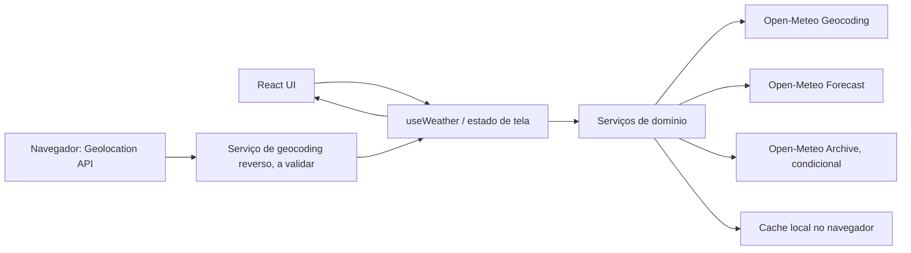

# Plano Técnico — Weather App

## Architecture

Aplicação cliente única em React + Vite, sem backend próprio, autenticação ou persistência de produto no servidor. A UI consome os serviços meteorológicos diretamente do navegador; estado de tela, preferências, favoritas, cidade lembrada e cache vivem no cliente.



**Gate anterior à implementação:** realizar a prova de conceito (PoC) do Open-Meteo para cobertura, campos, limites e termos de uso. Busca por código postal e histórico só permanecem no MVP se a PoC comprovar suporte suficiente. Se outra capacidade essencial falhar, suspender implementação e obter decisão de escopo. A PoC também deve validar como resolver coordenadas do dispositivo em uma cidade; não assumir que o serviço de geocoding escolhido oferece geocoding reverso.

Princípios arquiteturais:

- Dependências unidirecionais: `components` → `hooks` → `services` → APIs/recursos do navegador. As camadas podem importar funções puras de `lib` e contratos de `types`; `lib` não importa UI, serviços ou recursos do navegador.
- `components` apresentam dados/estados e emitem ações por props; não fazem chamadas de rede nem acessam armazenamento.
- `hooks` orquestram estado e operações assíncronas; não contêm detalhes de URLs ou payloads dos provedores.
- `services` encapsulam chamadas externas e efeitos de navegador (fetch, geolocalização e localStorage); traduzem erros externos para erros do domínio.
- `lib` contém funções puras e determinísticas, incluindo conversão, formatação, códigos WMO, validação e mapeamento de payloads.
- `types` contém contratos compartilhados, sem dependências de runtime.
- Normalizar respostas externas para modelos de domínio antes de chegar aos componentes.
- Manter estados e erros independentes por bloco meteorológico, mesmo quando clima atual e previsão vierem da mesma resposta HTTP.
- Não gravar coordenadas precisas do dispositivo, respostas de API ou dados do usuário no servidor.
- Não coletar analytics no MVP.

## Tech Stack

| Área | Decisão | Uso |
|---|---|---|
| Linguagem | TypeScript em modo strict | Contratos e modelos de domínio. |
| UI | React 19 + Vite | Site responsivo de página única. |
| Estilo | Tailwind CSS 3 | Seguir o tema e os padrões já definidos no repositório. |
| Dados meteorológicos | Open-Meteo, sem API key | Geocoding, previsão e, condicionalmente, arquivo histórico. |
| Estado | React `useReducer`/hooks locais | Sem biblioteca de estado adicional para este escopo. |
| Persistência cliente | `localStorage` com leitura/escrita defensiva | Preferência, favoritos, cidade lembrada e cache com TTL. |
| Testes unitários/componentes | Vitest + Testing Library | Funções, serviços e estados da UI. |
| Testes E2E | Playwright | Fluxos completos e viewports desktop/mobile. |
| Lint/format | Biome | Seguir configuração existente. |
| Gerenciador | pnpm | Comandos e dependências do workspace atual. |

Não adicionar biblioteca de query, estado global, backend ou camada de autenticação sem necessidade demonstrada. Os scripts e versões instaladas estão definidos em `package.json`.

## Project Structure

Manter a estrutura atual e adicionar módulos somente onde a separação de responsabilidades exigir:

```text
src/
  components/
    SearchBar.tsx
    CurrentWeather.tsx
    ForecastCard.tsx
    ForecastList.tsx
    HistoryPanel.tsx           # somente se a PoC mantiver FR-04
    UnitToggle.tsx
    states/
      EmptyState.tsx
      ErrorState.tsx
      LoadingState.tsx
  hooks/
    useWeather.ts              # estado e orquestração do fluxo meteorológico
  services/
    weatherService.ts         # chamadas Forecast/Archive e erros de domínio
    geocodingService.ts       # busca e normalização de cidades
    geolocationService.ts     # wrapper da Geolocation API e resolução da cidade
    browserStorageService.ts  # favoritos, preferências e cache local com TTL
  lib/
    format.ts                 # formatação de datas, horas e valores
    temperature.ts            # conversão C/F e arredondamento
    weatherCodes.ts           # descrição de códigos WMO
    openMeteoMappers.ts       # mapeadores puros de payload para tipos de domínio
  types/
    weather.ts                # tipos e contratos compartilhados
  styles/
    index.css

tests/
  unit/
    weatherService.test.ts
    geocodingService.test.ts
    browserStorageService.test.ts
    temperature.test.ts
    openMeteoMappers.test.ts
    useWeather.test.tsx
    SearchBar.test.tsx
  e2e/
    weather.spec.ts
```

`components` cuidam apenas da apresentação e acessibilidade; `hooks` coordenam estado/efeitos; `services` são a fronteira de I/O; `lib` fica livre de efeitos colaterais; `types` define os contratos. O cache e o acesso a `localStorage` pertencem a `browserStorageService`, não a `lib`.

Os nomes acima são responsabilidades propostas, não arquivos de implementação a criar agora. Manter os testes unitários em `tests/unit/` como no repositório, com nomes que identifiquem a camada, sem criar uma hierarquia de pastas de teste desnecessária. Se a PoC retirar histórico ou busca postal, remover seus contratos, critérios e cobertura de teste antes da fase Code.

## Data Model

Armazenar temperaturas normalizadas em Celsius e converter somente na apresentação. Datas/hora devem manter o offset ou fuso da cidade; não reinterpretar datas locais como UTC.

```ts
export type Unit = "celsius" | "fahrenheit";

export interface City {
  id: number; // Identificador da localidade retornado pelo geocoding.
  name: string; // Nome da cidade retornado pelo geocoding.
  region?: string; // Estado ou região administrativa, quando disponível.
  country: string; // Nome do país retornado pelo geocoding.
  latitude: number; // Latitude da cidade resolvida, não do dispositivo.
  longitude: number; // Longitude da cidade resolvida, não do dispositivo.
  timezone: string; // Fuso IANA usado para agrupar datas e horários locais.
}

export interface CurrentWeather {
  observedAt: string; // Horário local da observação, conforme a resposta da API.
  conditionCode: number | null; // Código WMO da variável weather_code, null se ausente.
  temperatureC: number | null; // temperature_2m, normalizada para graus Celsius.
  feelsLikeC: number | null; // apparent_temperature, normalizada para graus Celsius.
  todayMinC: number | null; // temperature_2m_min para a data local atual.
  todayMaxC: number | null; // temperature_2m_max para a data local atual.
  windSpeedKmh: number | null; // wind_speed_10m, normalizada para km/h.
  relativeHumidityPercent: number | null; // relative_humidity_2m, em porcentagem.
  precipitationProbabilityRemainingDayPercent: number | null; // Derivada de precipitation_probability horária; null se indisponível ou sem regra aprovada.
}

export interface ForecastDay {
  date: string; // Data local da série daily.time.
  conditionCode: number | null; // Código WMO da variável daily.weather_code.
  minC: number | null; // daily.temperature_2m_min, normalizada para Celsius.
  maxC: number | null; // daily.temperature_2m_max, normalizada para Celsius.
  precipitationProbabilityMaxPercent: number | null; // daily.precipitation_probability_max, em porcentagem.
}

export interface HistoricalDay {
  date: string; // Data local retornada pelo endpoint de arquivo.
  conditionCode: number | null; // Código WMO da condição histórica.
  minC: number | null; // Temperatura mínima observada, normalizada para Celsius.
  maxC: number | null; // Temperatura máxima observada, normalizada para Celsius.
  precipitationObservedMm: number | null; // Precipitação observada no dia, em milímetros.
}

export interface WeatherData {
  city: City; // Cidade resolvida a que os dados pertencem.
  current: CurrentWeather | null; // Clima atual; null quando esse bloco não veio válido.
  forecast: ForecastDay[] | null; // Previsão diária; null quando esse bloco não veio válido.
  fetchedAt: string; // Instante da consulta à API, em ISO 8601 UTC.
  history?: HistoricalDay[]; // Histórico condicional à PoC, carregado sob demanda.
}

export type WeatherBlock = "current" | "forecast" | "history";
export type DataFreshness = "fresh" | "stale";

export type AsyncBlock<T> =
  | { status: "idle" }
  | { status: "loading"; previous?: T }
  | { status: "empty"; message: string }
  | { status: "success"; data: T; freshness: DataFreshness; fetchedAt: string; sourceError?: WeatherErrorCode }
  | { status: "error"; code: WeatherErrorCode; message: string; fallback?: T; missingFields?: string[]; fetchedAt?: string };

export type WeatherErrorCode =
  | "network"
  | "timeout"
  | "http"
  | "invalid_response"
  | "quota"
  | "not_found"
  | "unsupported";

export interface FavoriteCity {
  city: City;
  savedAt: string;
}

export interface StoredValue<T> {
  schemaVersion: 1;
  savedAt: string;
  value: T;
}
```

**Contratos e invariantes:**

- `City.latitude`/`longitude` são as coordenadas da cidade resolvida. Coordenadas brutas do dispositivo nunca fazem parte de `City`, `WeatherData`, armazenamento local ou requisição meteorológica.
- Campos que podem faltar por cobertura do provedor são `null` ou levam ao estado indisponível do bloco; nunca converter ausência em zero.
- `WeatherData.current` e `forecast` têm estados de UI separados. Um campo faltante não invalida outros campos recebidos; a regra de completude para a métrica de PoC/release considera o bloco uma falha se faltar campo requerido.
- `HistoricalDay` e `WeatherData.history` só entram no contrato do MVP após a PoC.
- `precipitationProbabilityRemainingDayPercent` não é um campo atual direto da API: depende da série horária `precipitation_probability` e de uma regra de agregação ainda a validar; usar `null` até haver valor aprovado.
- `StoredValue` inclui versão de schema e timestamp para possibilitar descartar entradas incompatíveis ou expiradas.

## Data Flow

1. O usuário digita uma busca. Normalizar espaços; para vazio ou menos de dois caracteres, não chamar geocoding. Acima do limite, consultar até cinco sugestões. O intervalo de debounce ainda depende de decisão registrada na spec.
2. `geocodingService` converte o resultado do Open-Meteo para `City`. Para nomes homônimos, a UI exige seleção explícita; nenhuma consulta meteorológica ocorre antes da seleção.
3. Ao selecionar a cidade, `weatherService` solicita clima atual e previsão usando latitude/longitude da cidade e `timezone=auto`. Normaliza os campos e os separa por bloco para a UI.
4. A UI atualiza os estados de clima e previsão independentemente. Valores ausentes ficam indisponíveis; resposta parcial não apaga os demais campos/blocos válidos.
5. A resposta é guardada no cache local por cidade e bloco, com timestamp. Cache expira após 24 horas. Preferência de unidade, até cinco favoritas e cidade resolvida (se houver consentimento, por 30 dias) também são locais.
6. A previsão usa hoje e os quatro dias seguintes no fuso local da cidade. O histórico condicional é solicitado somente quando a aba de histórico abre, para hoje-7 até ontem no calendário local da cidade.
7. A atualização automática ocorre a cada 30 minutos enquanto a página está visível. Pausar enquanto oculta; ao retornar, atualizar imediatamente se o último dado tiver 30 minutos ou mais. Atualização manual segue o mesmo fluxo.
8. Fluxo de localização: após ação explícita e permissão do navegador, `geolocationService` obtém coordenadas precisas em memória. Transmiti-las somente ao serviço escolhido para resolver a cidade. Descartá-las após a resolução; solicitar dados meteorológicos usando apenas as coordenadas de `City`. A PoC deve determinar o serviço/endereço de geocoding reverso, pois não está definido pela spec.
9. Em falha, procurar cache local válido para o mesmo bloco. Mostrar cache com marcador stale e `fetchedAt`; sem cache válido, mostrar erro e ação de retry. Não gravar respostas meteorológicas no servidor.
10. Analytics permanece desligado: nenhum evento, payload de usuário ou chamada de coleta é gerado.

## External APIs

### Open-Meteo Geocoding

- **URL de exemplo:** `https://geocoding-api.open-meteo.com/v1/search?name=S%C3%A3o+Paulo&count=5&language=pt&format=json`
- **Parâmetros relevantes:** `name` é o texto da busca; `count=5` limita sugestões; `language=pt` solicita nomes em português quando disponíveis; `format=json` seleciona JSON. Só chamar após dois caracteres e com busca não vazia. Código postal permanece condicional à PoC.
- **Resposta resumida (valores ilustrativos):**

```json
{
  "results": [
    {
      "id": 1234567,
      "name": "São Paulo",
      "latitude": -23.5505,
      "longitude": -46.6333,
      "elevation": 760,
      "feature_code": "PPLA",
      "country_code": "BR",
      "admin1": "São Paulo",
      "timezone": "America/Sao_Paulo",
      "country": "Brasil"
    }
  ],
  "generationtime_ms": 0.1
}
```

- **Mapeamento para `City`:** `id` → `id`; `name` → `name`; `admin1` → `region`; `country` → `country`; `latitude`/`longitude` → coordenadas da cidade; `timezone` → `timezone`. Se `timezone` não vier no resultado, usar o valor retornado pelo endpoint Forecast. `country_code`, `elevation` e `feature_code` podem ser descartados se a UI não os exigir.
- **PoC:** testar nomes internacionais, homônimos, aliases/acentos e cobertura por região. Tratar resultado sem `results` ou com lista vazia como cidade não encontrada. Debounce e volume de autocomplete ainda precisam ser definidos; não presumir que o limite de consultas meteorológicas inclua geocoding.

### Open-Meteo Forecast

- **URL de exemplo:** `https://api.open-meteo.com/v1/forecast?latitude=-23.5505&longitude=-46.6333&current=temperature_2m,relative_humidity_2m,apparent_temperature,weather_code,wind_speed_10m&daily=weather_code,temperature_2m_max,temperature_2m_min,precipitation_probability_max&hourly=precipitation_probability&temperature_unit=celsius&wind_speed_unit=kmh&precipitation_unit=mm&timezone=auto&forecast_days=5`
- **Parâmetros relevantes:** `latitude`/`longitude` são os da cidade resolvida; `current` pede condições atuais; `daily` pede séries por dia; `hourly=precipitation_probability` fornece a série horária necessária para avaliar chuva restante no dia; `timezone=auto` usa o fuso das coordenadas e o devolve na resposta; `forecast_days=5` solicita hoje e os quatro dias seguintes; `temperature_unit=celsius`, `wind_speed_unit=kmh` e `precipitation_unit=mm` fixam as unidades recebidas.
- **Resposta resumida (valores ilustrativos; arrays diários usam o mesmo índice para cada data):**

```json
{
  "latitude": -23.55,
  "longitude": -46.625,
  "timezone": "America/Sao_Paulo",
  "utc_offset_seconds": -10800,
  "current_units": {
    "time": "iso8601",
    "temperature_2m": "°C",
    "relative_humidity_2m": "%",
    "apparent_temperature": "°C",
    "weather_code": "wmo code",
    "wind_speed_10m": "km/h"
  },
  "current": {
    "time": "2026-10-29T14:00",
    "temperature_2m": 24.6,
    "relative_humidity_2m": 62,
    "apparent_temperature": 25.1,
    "weather_code": 2,
    "wind_speed_10m": 12.4
  },
  "hourly": {
    "time": ["2026-10-29T14:00", "2026-10-29T15:00"],
    "precipitation_probability": [20, 35]
  },
  "daily_units": {
    "time": "iso8601",
    "weather_code": "wmo code",
    "temperature_2m_max": "°C",
    "temperature_2m_min": "°C",
    "precipitation_probability_max": "%"
  },
  "daily": {
    "time": ["2026-10-29", "2026-10-30", "2026-10-31", "2026-11-01", "2026-11-02"],
    "weather_code": [2, 61, 3, 1, 2],
    "temperature_2m_max": [27.2, 24.5, 25.1, 26.0, 27.0],
    "temperature_2m_min": [18.4, 17.9, 18.1, 18.5, 19.0],
    "precipitation_probability_max": [35, 70, 40, 10, 15]
  }
}
```

- **Mapeamento para `City`:** coordenadas do request identificam a cidade; `timezone` da resposta é a fonte autoritativa para `City.timezone` se o geocoding não a retornar.
- **Mapeamento para `CurrentWeather`:** `current.time` → `observedAt`; `weather_code` → `conditionCode`; `temperature_2m` → `temperatureC`; `apparent_temperature` → `feelsLikeC`; `wind_speed_10m` → `windSpeedKmh`; `relative_humidity_2m` → `relativeHumidityPercent`. As temperaturas mínima/máxima do dia vêm dos elementos de `daily.temperature_2m_min/max` cuja `daily.time` coincide com a data local atual.
- **Mapeamento para `ForecastDay`:** percorrer os arrays `daily` pelo índice de `daily.time`: `time` → `date`; `weather_code` → `conditionCode`; `temperature_2m_min/max` → `minC`/`maxC`; `precipitation_probability_max` → `precipitationProbabilityMaxPercent`.
- **Mapeamento para `WeatherData`:** associar `City`, o bloco `CurrentWeather`, os cinco `ForecastDay` e o instante local da consulta em `fetchedAt` (normalizado pelo cliente para ISO 8601 UTC). Se um bloco for inválido ou ausente, representá-lo como `null` e manter estado independente para os demais.
- **Probabilidade restante do dia:** `daily.precipitation_probability_max` representa o máximo diário e não deve ser mapeado diretamente como probabilidade restante. O valor de `CurrentWeather.precipitationProbabilityRemainingDayPercent` depende da série `hourly.precipitation_probability` a partir do horário atual até o fim do dia local; a regra de agregação continua pendente na spec. Até sua aprovação, mapear como `null`.
- **Não enviar:** coordenadas precisas obtidas diretamente do dispositivo; enviar somente latitude/longitude da cidade resolvida.

### Open-Meteo Archive (condicional)

- **Base:** `https://archive-api.open-meteo.com/v1/archive`
- **Uso previsto:** histórico diário de sete datas anteriores somente se a PoC confirmar os campos requeridos e cobertura suficiente.
- **Parâmetros conceituais:** latitude/longitude da cidade, `start_date`/`end_date` no fuso local, `daily` com código de condição, temperatura máxima/mínima e precipitação observada, além de `timezone=auto`.
- **Gate:** se suporte for insuficiente, excluir FR-04, US-03 relacionado ao histórico e AC-03.1 a AC-03.3 do escopo de implementação. Não substituir automaticamente por outro serviço.

### Geocoding reverso da localização

- **Entrada:** coordenadas temporárias obtidas pela Geolocation API do navegador após ação explícita do usuário.
- **Saída:** cidade resolvida e coordenadas representativas dessa cidade.
- **Provedor:** ainda não definido/validado na spec. A PoC deve identificar se Open-Meteo atende ao fluxo; caso contrário, obter decisão de serviço e termos antes de implementar localização.
- **Privacidade:** coordenadas brutas não são armazenadas nem enviadas ao endpoint meteorológico. O serviço de reverse geocoding recebe as coordenadas apenas para localizar a cidade.

## State Management

O estado de domínio da tela vive em `useReducer` encapsulado no hook `useWeather`, no nível da tela/app. O hook coordena consulta, cidade selecionada, atualização e estados independentes por bloco; não guardar estado meteorológico em componentes nem introduzir biblioteca global.

Estados assíncronos explícitos para busca, clima atual, previsão e histórico:

- `idle`: operação ainda não iniciada ou sem cidade selecionada.
- `loading`: operação em andamento; pode manter dados anteriores como `previous`, sem tratá-los como resposta nova.
- `success`: dados válidos; `freshness` identifica resposta atual ou cache stale. `sourceError` pode indicar que a resposta veio de cache após falha do provedor.
- `error`: falha sem resposta completa utilizável. `fallback` contém dados parciais ou cache para exibição, `missingFields` identifica lacunas e `code` classifica a causa.
- `empty`: operação concluída sem resultados, por exemplo, geocoding sem cidades ou histórico sem registros; não é erro de rede.

Os controles transitórios de apresentação (por exemplo, foco e abertura visual de sugestões) podem ficar localmente no componente. Unidade, favoritas e cidade lembrada são carregadas do `browserStorageService`; cache e preferências são persistidos somente no navegador.

Estado mínimo proposto:

```ts
export interface WeatherPageState {
  query: string;
  suggestions: AsyncBlock<City[]>;
  selectedCity: City | null;
  current: AsyncBlock<CurrentWeather>;
  forecast: AsyncBlock<ForecastDay[]>;
  history: AsyncBlock<HistoricalDay[]>;
  activeView: "forecast" | "history";
  unit: Unit;
  favorites: FavoriteCity[];
  rememberedCity: City | null;
}
```

- Ações do reducer devem representar eventos observáveis (`SEARCH_STARTED`, `CITY_SELECTED`, `BLOCK_SUCCEEDED`, `BLOCK_EMPTY`, `BLOCK_FAILED`, `REFRESH_REQUESTED`, `VISIBILITY_CHANGED`, `UNIT_CHANGED`, `FAVORITE_ADDED`, `FAVORITE_REMOVED`).
- Serviços recebem parâmetros explícitos e retornam dados normalizados ou erros tipados; o hook decide transições de estado.
- `localStorage` é acessado por adaptador simples que valida JSON e schema, trata `SecurityError`/quota e degrada para sessão em memória sem bloquear consultas.
- Não guardar coordenadas do dispositivo, eventos de analytics ou dados pessoais no estado persistido.
- Estado meteorológico e cache mantêm temperatura em Celsius. Durante a renderização, a UI chama funções puras de `lib/temperature` para derivar o valor em Celsius ou Fahrenheit e formatá-lo com uma casa decimal; não alterar os dados originais nem chamar serviço/API ao trocar unidade.

## Error Handling

| Condição | Transição/ação | Resultado visível |
|---|---|---|
| Antes de iniciar uma operação | `idle` | Sem erro; busca aguarda entrada ou seleção de cidade. |
| Busca ou bloco iniciado | `loading` | Indicador do bloco; preservar `previous` sem apresentá-lo como dado recém-atualizado. |
| Geocoding conclui sem resultados ou histórico sem registros | `empty` | Mensagem específica e ação apropriada; não solicitar forecast para cidade inexistente. |
| Rede indisponível | `success` stale com `sourceError=network`, se houver cache local do mesmo bloco com até 24h; caso contrário `error` | Aviso e timestamp no fallback; sem cache, erro e ação manual de tentar novamente. Não repetir automaticamente até a política de retry ser definida. |
| API retorna HTTP não-success | Classificar `429` como `quota`; demais respostas como `http`; `5xx` pode usar cache | Aplicar fallback válido do mesmo bloco ou exibir erro com retry manual. Não tratar falha HTTP como cidade inexistente. |
| Resposta JSON inválida ou schema inesperado | `error` com `invalid_response` | Não renderizar valores não validados; usar cache local válido se disponível, senão erro e retry manual. |
| Timeout | Abortar a requisição com `AbortController` e transicionar para `success` stale se houver cache válido, senão `error` com `timeout` | Mostrar aviso de cache ou erro e retry manual. A duração máxima permanece pendente na spec; cancelar também requisições obsoletas de outra cidade. |
| Resposta parcial/campo ausente | Mapear campos numéricos ausentes para `null`; se faltar campo requerido, `error` com `fallback` parcial e `missingFields` | Exibir campos recebidos e marcar ausentes como indisponíveis; nunca usar zero ou inferir valor. Contar bloco incompleto como falha na métrica de sucesso. |
| Um bloco falha e outros têm dados válidos | Transição independente por bloco | Manter blocos válidos visíveis; não transformar falha de forecast/histórico em falha de clima atual, nem ocultar o aviso do bloco. |
| `localStorage` indisponível/cheio | Fallback em memória | Consultas continuam; preferências, favoritas e cache podem não persistir e isso é informado quando relevante. |
| Analytics no MVP | Nenhuma transição de coleta | Nenhuma chamada ou payload de analytics é gerado. |

Limite de timeout, quantidade/intervalo de retry automático (mantido desativado até decisão) e textos finais de erro devem ser definidos antes de codificar. Não registrar consulta, coordenadas do dispositivo ou payloads meteorológicos em logs de terceiros.

## Testing Strategy

- **Gate de PoC:** antes da implementação, testar em conjunto representativo de cidades/países: busca por nome e homônimos, cobertura de campos atuais e cinco dias, histórico de sete dias, timezone, termos, limites, latência e reverse geocoding. Registrar resultados e remover postal/histórico do MVP se não atenderem ao gate.
- **Testes de `lib` (Vitest):** testar funções puras por entradas/saídas; normalização de busca, mapeadores dos payloads, códigos WMO, conversão C/F, arredondamento e tratamento de timezone. Sem mocks de navegador/rede.
- **Testes de `services`:** mock de `fetch`, Geolocation API e storage; cobrir sucesso, timeout, erro HTTP, cota, JSON/schema inválido, campos ausentes, respostas parciais, TTL e fallback de cache. Nunca chamar Open-Meteo real nos testes automatizados.
- **Testes de hooks:** verificar transições idle/loading/success/error/empty por bloco, refresh, seleção de cidade, retorno da aba visível e carregamento sob demanda do histórico.
- **Testes de componentes:** Testing Library com queries acessíveis; verificar debounce quando definido, mínimo de dois caracteres, lista máxima de cinco, desambiguação, estados idle/loading/success/error/empty, conversão derivada e ausência de chamadas de serviço ao alternar unidade, limites de favoritas, localização negada e ausência de chamadas de analytics.
- **E2E (Playwright):** interceptar todas as APIs com `page.route`; percorrer busca → seleção → clima/previsão, atualização manual/automática, aba de histórico quando habilitada, localização concedida/negada, cache expirado e ausência de autenticação. Cobrir viewport a partir de 375 px e desktop.
- **Acessibilidade:** verificar teclado, foco, labels/roles e fluxos críticos; incluir checagens automatizadas e validação manual compatível com WCAG 2.2 AA.
- **NFRs operacionais:** usar verificações sintéticas do shell para a meta de 99%; medir 3s e taxa de sucesso em ambiente controlado após definir perfil de rede, cidades de amostra e protocolo. Sem analytics de usuários.
- **Gate condicional:** se PoC retirar histórico ou busca postal, remover seus testes e critérios de MVP antes de iniciar tarefas de implementação.

## Risks & Trade-offs

| Risco/decisão | Trade-off | Mitigação/condição |
|---|---|---|
| Open-Meteo pode não cobrir histórico, busca postal ou todas as regiões/campos | Reduz dependências e evita API key, mas pode exigir reduzir escopo. | PoC obrigatória antes do plano de tarefas; excluir somente postal/histórico quando insuficientes; outras falhas essenciais exigem decisão de escopo. |
| Reverse geocoding não está validado | Geolocalização pode depender de um serviço adicional, seus termos e disponibilidade. | Não encaminhar coordenadas brutas à API meteorológica; selecionar/validar o serviço antes de implementar FR-06. |
| Chamadas diretas do browser ao provedor | Simplifica arquitetura e elimina backend/segredos, mas depende de CORS e disponibilidade externa. | Verificar CORS e limites na PoC; cache local e erros por bloco. Se um provedor exigir credencial secreta, não expô-la no cliente; parar e revisar arquitetura/escopo. |
| Cache local pode ser apagado ou divergir entre dispositivos | Menor custo e sem persistência de servidor, sem sincronização ou continuidade em outros dispositivos. | Aceitar perda de cache/favoritos e manter consulta manual; tratar armazenamento local indisponível como degradação não fatal. |
| Dados stale de até 24h | Melhora disponibilidade, mas não representa necessariamente o tempo atual. | Aviso e timestamp obrigatórios; descartar cache vencido. |
| Atualizar cada 30 min e autocomplete podem exceder limites | Atualidade compete com cota do provedor. | Pausar aba oculta, avaliar chamadas de autocomplete separadamente, definir debounce após limite conhecido. |
| Um endpoint pode alimentar clima atual e previsão | Menos chamadas, mas falha HTTP pode afetar ambos. | Estados independentes e renderização parcial; métricas de sucesso por bloco. |
| Sem analytics de usuário | Protege privacidade, mas reduz visibilidade de problemas de uso real. | Métricas por testes sintéticos/PoC e feedback voluntário sem registrar eventos de comportamento. |
| Requisitos de performance, timeout e disponibilidade ainda sem protocolo completo | Critérios podem não ser reprodutíveis entre ambientes. | Definir rede, cadence de probes, timeout e retry antes de transformar em tarefas de implementação. |
